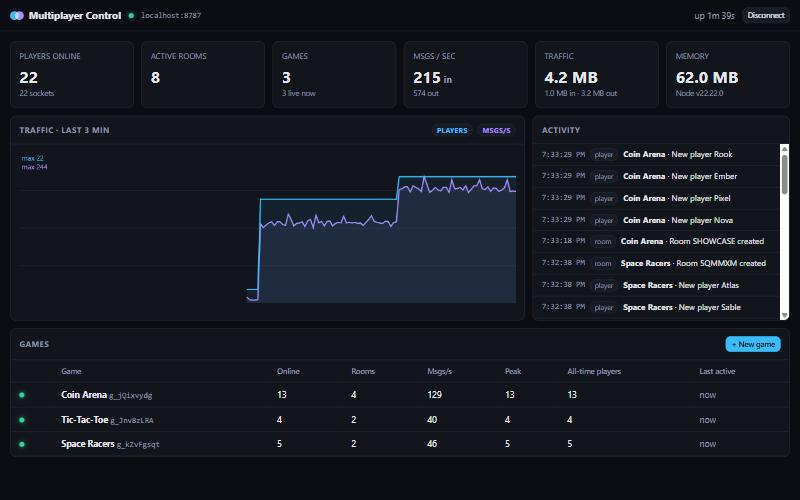
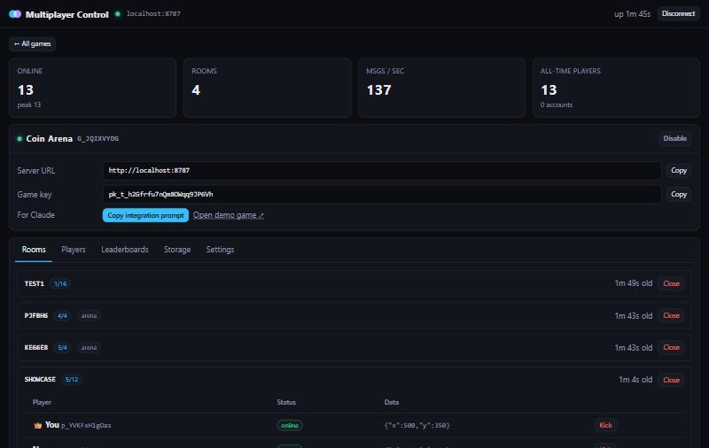
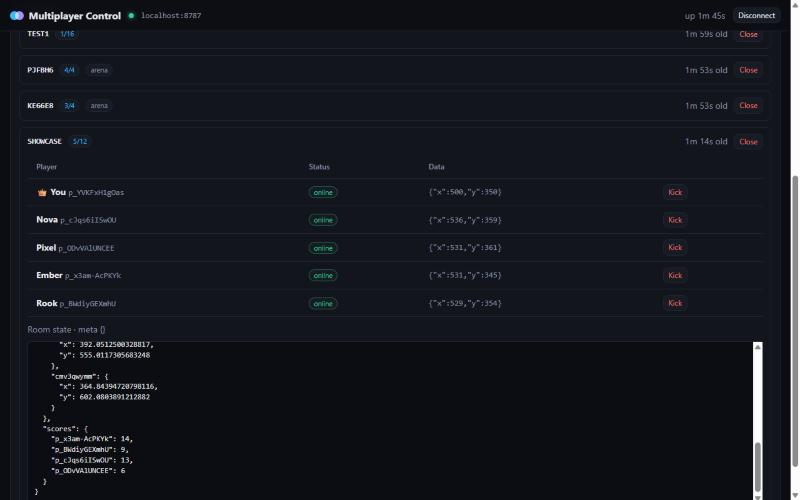
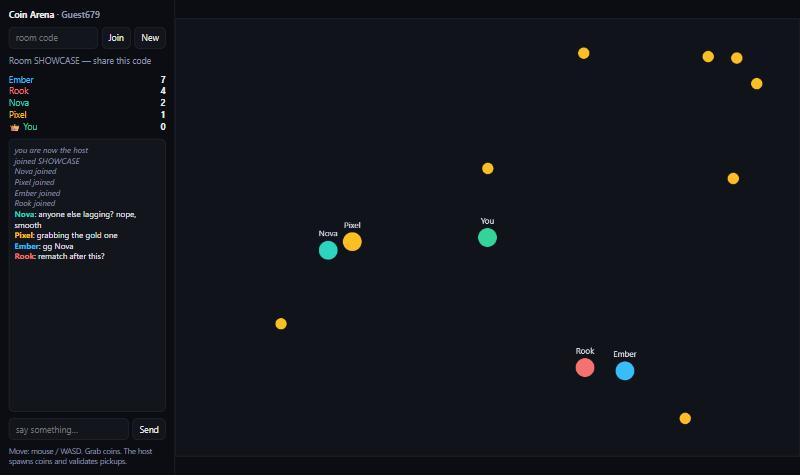

# Multiplayer Game System

A self-hosted, game-agnostic multiplayer backend. One Docker stack on your VPS gives you:

- **Realtime rooms**: share codes, matchmaking (`quickJoin`), host election and migration, kick/ban, locking, passwords, reconnects that keep the player's slot.
- **Three sync channels**: ordered shared room state, per-player data, and relay messages (to everyone, the host, or specific players, plus DMs).
- **Persistence (SQLite)**: per-player, private and game-wide key/value storage, atomic counters, persistent rooms, leaderboards, username/password accounts.
- **Admin**: a dashboard (static HTML that runs on GitHub Pages or from the server itself) with live traffic, games, rooms, players, storage browser, leaderboards and broadcasts.
- **Security**: per-game public keys, an admin bearer token, HMAC-signed player tokens, scrypt passwords, rate limits, message size caps, origin allow-lists, auto-HTTPS via Caddy.



| Game detail: key, Claude prompt, live rooms | Room inspector: players, data, live state |
|---|---|
|  |  |

**Demo game** (`/demo`): five players in one room. The host spawns coins and validates every pickup.



```
server/         Node 24 server (ws + node:sqlite), Dockerfile, smoke test
client/         multiplayer.js: browser/Node SDK (served at /sdk.js)
docs/           Dashboard (GitHub Pages root, also served at /)
examples/       demo.html: Coin Arena demo (served at /demo)
MULTIPLAYER.md  Integration guide to hand to any Claude chat
```

## Deploy on the Hostinger KVM 2

```bash
ssh root@YOUR_VPS_IP
git clone <your-repo-url> mp && cd mp       # or scp this folder up
sh deploy.sh
```

`deploy.sh` installs Docker if it's missing and creates `.env` with a random `ADMIN_TOKEN`. It sets `DOMAIN=<ip-with-dashes>.sslip.io`, a free hostname that resolves to your IP, so HTTPS works without buying a domain. It then opens ports 80 and 443 in ufw and runs `docker compose up -d --build`. To use your own domain, point an A record at the VPS, set `DOMAIN=` in `.env`, and run `docker compose up -d`.

Make sure ports 80 and 443 are open in the Hostinger panel firewall too.

| URL | What it is |
|---|---|
| `https://DOMAIN/` | Dashboard |
| `https://DOMAIN/demo` | Demo game. Open it from a game's page in the dashboard so the key is filled in. |
| `https://DOMAIN/sdk.js` | Client SDK |
| `https://DOMAIN/MULTIPLAYER.md` | Integration guide |
| `wss://DOMAIN/ws` | WebSocket endpoint |
| `https://DOMAIN/health` | Health check |

Operations:

```bash
docker compose logs -f mp                 # logs
docker compose up -d --build              # update after git pull
docker compose exec mp cat /data/mp.db > backup.db   # or back up the mp-data volume
```

## Dashboard on GitHub Pages

Push the repo, then go to **Settings → Pages → Deploy from branch → `main` / `/docs`**. Open the Pages URL and enter your server URL and admin token. They're stored only in that browser's localStorage. The same dashboard is also served from the VPS at `/`.

## Adding multiplayer to a game

1. In the dashboard, click **+ New game** to get a game key.
2. Click **Copy integration prompt** and paste it into any Claude chat or Claude Code session, along with `MULTIPLAYER.md`. Claude can also fetch the guide from `https://DOMAIN/MULTIPLAYER.md`.

## Local development

```bash
cd server && npm install && npm start     # http://localhost:8080, admin token printed on first run
npm test                                  # end-to-end smoke test (26 checks)
```

## Configuration (`.env`)

| Var | Default | |
|---|---|---|
| `DOMAIN` | – | Hostname for Caddy TLS |
| `ADMIN_TOKEN` | auto-generated, printed in logs | Dashboard and admin API bearer token (≥16 chars) |
| `OPEN_GAMES` | `false` | When `true`, any unknown key ≥8 chars auto-creates a game. Dev convenience only. |
| `RATE_LIMIT` / `RATE_BURST` | `60` / `200` | Messages per second per connection |
| `MAX_MSG_BYTES` | `65536` | Maximum size per message and per stored value |
| `RECONNECT_GRACE_MS` | `15000` | How long a dropped player keeps their room slot |
| `MAX_ROOM_PLAYERS` | `256` | |
| `MAX_CONNS_PER_IP` | `50` | |

## Admin REST API

All routes take `Authorization: Bearer ADMIN_TOKEN`.

`GET /api/admin/overview` · `GET|POST /api/admin/games` · `GET|PATCH|DELETE /api/admin/games/:id` (PATCH accepts `{name, enabled, rotateKey, settings:{allowedOrigins, gameDataWrite}}`) · `POST /api/admin/games/:id/rooms/:room/close|kick|state` · `POST /api/admin/games/:id/broadcast` · `GET|PUT|DELETE /api/admin/games/:id/kv` · `GET|DELETE /api/admin/games/:id/leaderboards/:board`
